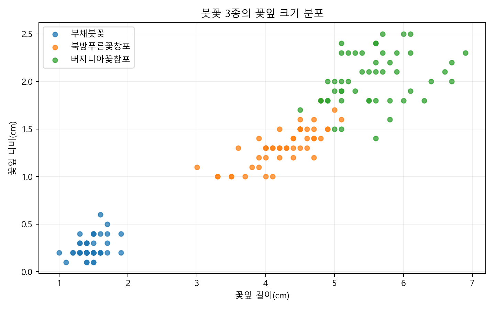
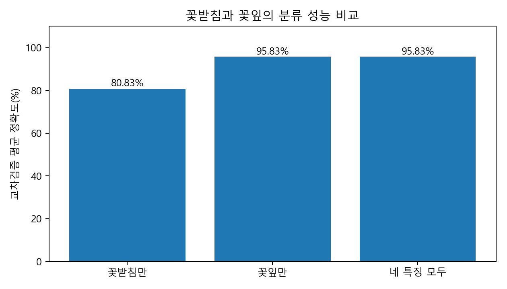

# 붓꽃의 형태적 특징을 활용한 인공지능 종 분류

## 1. 프로젝트 소개

본 프로젝트는 가천대학교 교양과목인 '식물과 인간'의 프로젝트로 진행하였습니다.

붓꽃의 꽃잎과 꽃받침의 길이, 너비를 이용하여 인공지능이 붓꽃의 종을 구분할 수 있는지 알아보는 것이 목적입니다.

머신러닝을 처음 접하는 사람도 이해할 수 있도록 비교적 간단한 두 가지 분류 모델을 사용하였습니다.

## 2. 분류 대상

이번 프로젝트에서는 세 종류의 붓꽃을 분류합니다.

- **Iris setosa (부채붓꽃)**
- **Iris versicolor (북방푸른꽃창포)**
- **Iris virginica (버지니아꽃창포)**

## 3. 사용한 데이터

scikit-learn에서 제공하는 Iris 데이터셋을 사용하였습니다.

총 150개의 데이터가 있으며, 각 붓꽃의 다음 네 가지 특징을 이용합니다.

1. 꽃받침 길이 (Sepal Length)
2. 꽃받침 너비 (Sepal Width)
3. 꽃잎 길이 (Petal Length)
4. 꽃잎 너비 (Petal Width)

전체 데이터 중 120개는 모델 학습에, 30개는 최종 테스트에 사용하였습니다.

## 4. 사용한 인공지능 모델

### 의사결정나무 (Decision Tree)

꽃잎과 꽃받침의 크기를 기준으로 질문을 반복하며 붓꽃의 종을 구분하는 모델입니다.

### KNN (K-Nearest Neighbors)

새로운 붓꽃과 특징이 비슷한 기존 붓꽃들을 찾아 어떤 종에 가까운지 판단하는 모델입니다.

## 5. 실험 결과

| 모델 | 교차검증 평균 정확도 | 테스트 정확도 |
|---|---|---|
| 의사결정나무 | 95.83% | 96.67% |
| KNN | 95.83% | 93.33% |

의사결정나무 모델은 시험 데이터 30개 중 29개를 정확하게 분류하였으며, KNN 모델은 28개를 정확하게 분류하였습니다.

또한 꽃받침만 사용했을 때와 꽃잎만 사용했을 때의 정확도를 비교하였습니다.

- 꽃받침만 사용: 80.83%
- 꽃잎만 사용: 95.83%

이 결과를 통해 이번 데이터에서는 꽃잎의 길이와 너비가 붓꽃의 종을 구분하는 데 더 유용하다는 것을 확인하였습니다.

## 6. 실험 결과 그래프

아래 그림은 Jupyter Notebook을 실행하여 만든 결과입니다. 그림을 클릭하면 원본 파일을 확인할 수 있습니다.

### 붓꽃 세 종의 꽃잎 크기 분포

점 하나는 붓꽃 표본 한 개를 나타냅니다. 부채붓꽃은 다른 두 종과 뚜렷하게 구분되지만, 북방푸른꽃창포와 버지니아꽃창포는 일부 측정값이 겹칩니다. 따라서 두 종을 혼동할 가능성이 있습니다.

### 꽃받침과 꽃잎 중 무엇이 더 도움이 될까?

같은 의사결정나무 모델에서 입력하는 측정값만 달리한 결과입니다. 꽃받침만 사용하면 80.83%, 꽃잎만 사용하면 95.83%의 교차검증 평균 정확도가 나왔습니다. 이 결과는 **이번 150개 표본의 실험**에 한정되며, 모든 붓꽃에 일반화할 수는 없습니다.

## 7. 실행 방법

본 프로젝트는 Python과 Jupyter Notebook을 이용하여 작성하였습니다.

1. GitHub에서 프로젝트 파일을 다운로드합니다.
2. Python 환경에 scikit-learn과 matplotlib을 설치합니다.
3. VS Code에서 `iris_project_practice.ipynb` 파일을 엽니다.
4. Python 커널을 선택한 뒤 `Run All`을 실행합니다.
5. 두 모델의 정확도와 실험 결과를 확인합니다.

필요한 라이브러리 설치 명령어:

`python -m pip install scikit-learn matplotlib ipykernel`

## 8. 프로젝트를 통해 알게 된 점

붓꽃의 형태적 특징을 숫자로 표현하면 인공지능을 이용해 서로 다른 종을 분류할 수 있다는 것을 확인하였습니다.

또한 모든 붓꽃을 정확하게 구분할 수 있는 것은 아니었으며, 서로 다른 종이라도 측정값이 비슷하면 잘못 분류할 수 있다는 점을 알게 되었습니다.

이번 프로젝트에서는 실제 꽃 사진이 아니라 이미 측정된 데이터를 사용하였으므로, 향후에는 실제 꽃 사진을 이용한 분류도 시도해 볼 수 있을 것입니다.

## 9. 참고자료

- [scikit-learn Iris Dataset](https://scikit-learn.org/stable/datasets/toy_dataset.html#iris-plants-dataset)
- [UCI Iris Dataset](https://archive.ics.uci.edu/dataset/53/iris)

## 10. 프로젝트 정보

- 과목: 식물과 인간
- 학과: 인공지능학과
- 개발 환경: Python, Jupyter Notebook, scikit-learn
